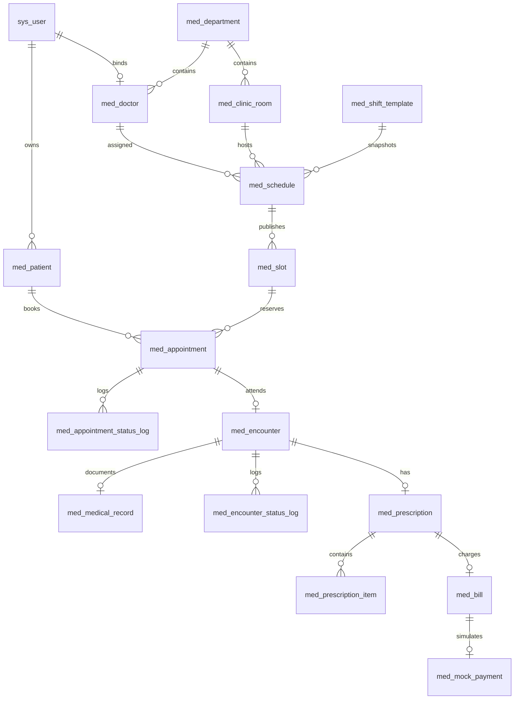

# MedFlow M0 现状审计

审计日期：2026-10-20。仓库：`E:\code\java\MedFlow`。HEAD：`3d967ef`，含大量未提交及未跟踪改动；本文审计的是当前工作区和正常 Docker 的实际运行版本，不能用 HEAD 代表全部工作区内容。

## 0. 最新业务决定及本次范围

**按用户最新明确意见，患者自行确认预约、自行签到。管理员审核、确认或拒绝预约不列为必做缺口。**

用户提供的 [v0.1 手册原文](MEDFLOW_REFACTOR_BASELINE_V0_1.md)保留原样。其第 2.3、4.1、5、6 节中管理员确认/拒绝/签到的文字，由上述最新决定覆盖。预约确认是患者核对就诊人、医生、日期时段后承诺就诊，不是医院审核。管理员辅助代签到仅为后续可选需求。

本轮在收到手册前已经产生医生公开资料、历史档案、预约页的代码草稿；收到“仅做 M0”后停止业务修改，未构建或替换正常 Docker 镜像。M0 只补审计文档、读取运行数据、运行现有测试；测试数据库独立且已清理。不能把这些草稿说成已交付页面。

审计状态采用三类：源码存在；本轮测试通过；正常 Docker 已运行。三类不互相替代，旧交付文档和图片仅为历史证据。

## 1. 版本、模块树与架构

| 项目 | 实际情况 | 证据 |
| --- | --- | --- |
| Java / Spring Boot | POM 是 Java 25、Spring Boot 3.5.16；本机本轮为 Temurin 25.0.3 | [pom.xml:12](E:/code/java/MedFlow/pom.xml:12)、[pom.xml:24](E:/code/java/MedFlow/pom.xml:24)、target/m0-audit-tests.log |
| 数据访问 | MyBatis 3.0.5，部分聚合查询/演示数据用 JdbcTemplate；MySQL 是最终业务事实来源 | [pom.xml:44](E:/code/java/MedFlow/pom.xml:44)、[AppointmentService.java:152](E:/code/java/MedFlow/src/main/java/com/qqlin/medflow/appointment/service/AppointmentService.java:152) |
| 安全 | Spring Security、JWT、BCrypt；Bearer 每次检查账号启停、角色和 tokenVersion | [SecurityConfig.java:63](E:/code/java/MedFlow/src/main/java/com/qqlin/medflow/identity/security/SecurityConfig.java:63)、[JwtAccountValidator.java:44](E:/code/java/MedFlow/src/main/java/com/qqlin/medflow/identity/security/JwtAccountValidator.java:44) |
| 前端 | 原生 HTML/CSS/JS，Hash 路由；随 Spring Boot JAR 托管，没有 Vue 构建项目 | [index.html:24](E:/code/java/MedFlow/src/main/resources/static/index.html:24)、[app.js:442](E:/code/java/MedFlow/src/main/resources/static/assets/app.js:442)、[Dockerfile:2](E:/code/java/MedFlow/Dockerfile:2) |
| 迁移 | 工作区 V1–V14；正常 Docker 仅 V1–V13；独立空库本轮 V1–V14 成功 | [V14:2](E:/code/java/MedFlow/src/main/resources/db/migration/V14__doctor_public_profile.sql:2)、[实际迁移证据](audit/m0-docker-db.txt)、target/m0-audit-mysql.log:67 |
| 部署 | 单体应用含前端 + MySQL 8.4.11 + Redis，三个容器 healthy；本机入口 127.0.0.1:8080 | [Compose:14](E:/code/java/MedFlow/docker-compose.yml:14)、[Compose:49](E:/code/java/MedFlow/docker-compose.yml:49)、[运行证据](audit/m0-runtime-ui.json) |

```text
src/main/java/com/qqlin/medflow/
  identity/       登录、JWT、角色和账号状态
  organization/   科室、诊室、医生账号绑定；detail/ 医生详情缓存
  patient/        就诊人及 owner 校验
    history/      本轮草稿：同一就诊人的纵向只读查询
  scheduling/     班次模板、排班、有限号源
    management/   管理员目录/批量/停诊、医生本人目录
  appointment/    创建、幂等、确认、取消、超时释放、历史、分页/游标
  encounter/      签到、候诊、开始/过号/完成、简版病历及版本
  medication/     演示药品目录
  billing/        简版处方、账单、模拟缴费
  statistics/     三项统计聚合
  bootstrap/      可选演示账号、滚动演示数据与幂等 registry
  shared/         统一响应、异常码、TraceId
  devtools/       仅 local profile 的响应演示
src/main/resources/
  db/migration/   Flyway V1–V14
  mapper/         MyBatis XML
  static/         API 客户端、工作台、预约、就诊、处方等页面
```

模块存在的证据见下一节逐项 Controller 路径；事务入口见第 4 节。主应用只有一个 Spring Boot 入口：[MedFlowApplication.java:6](E:/code/java/MedFlow/src/main/java/com/qqlin/medflow/MedFlowApplication.java:6)。没有拆出微服务、MQ 或 MongoDB 模块。

## 2. 真实 API、鉴权与可运行功能

完整逐方法清单：[M0 API 清单](audit/m0-api-inventory.md)。每条都有源码路径和行号，并核对正常 Docker OpenAPI。

- 工作区 63 个业务/开发方法：54 个存在于正常 Docker OpenAPI、5 个仅源码草稿、4 个仅 local profile。
- 5 个新增草稿路由是患者档案列表/详情、医生锚点档案列表/详情、公开医生目录。既有医生详情和 PUT profile 的字段在源码中也有扩展；同路径不代表新字段已经部署。
- `/api/v1/admin/**` 只允许 ADMIN；`/doctor/**` 只允许 DOCTOR；`/patient/**`、`/patients/**`、`/appointments/**` 只允许 PATIENT。[SecurityConfig.java:63](E:/code/java/MedFlow/src/main/java/com/qqlin/medflow/identity/security/SecurityConfig.java:63)
- 业务归属继续在 Service/SQL 检查，不能仅靠前端菜单或角色。患者 owner 条件见 [AppointmentMapper.xml:291](E:/code/java/MedFlow/src/main/resources/mapper/appointment/AppointmentMapper.xml:291)，医生归属见 [EncounterService.java:158](E:/code/java/MedFlow/src/main/java/com/qqlin/medflow/encounter/service/EncounterService.java:158)。

| 功能 | 源码和当前运行情况 | 本轮验证的实际范围 |
| --- | --- | --- |
| 三角色登录 | 正常 Docker 存在 | 三账号真实登录、角色接口和 401/403 共 19 项检查通过；不等于每个接口业务场景都通过 |
| 科室/诊室/医生 | 管理员创建/查询、开户绑定、患者目录已有 | MVC 普通测试通过；本轮未重新跑所有组织开户 MySQL IT |
| 排班与号源 | 草稿、发布、批量、目录、无有效预约的停诊已有 | 排班管理 MySQL 7 项、排班并发 4 项通过 |
| 预约闭环 | 患者创建→自确认→取消/超时；创建时扣容量 | 确认/查询/取消/越权/故障 32 项、幂等 1 项、容量竞争 1 项、超时策略 7 项、定时任务 1 项、死锁 2 项通过 |
| 签到和就诊 | 患者自签到；医生只操作自己的接诊、保存病历、完成/过号 | 接诊真实 MySQL 9 项通过 |
| 纵向院内档案 | 当前工作区有 API 和前端入口，正常 Docker 没有 | 新模块单测/MVC 随普通测试通过，真实 MySQL 7 项通过；未部署、未做浏览器验收 |
| 新预约交互 | booking.js/css 草稿存在，旧 viewSlots 仍在路由中 | 新交互未接线、无专用行为测试、未部署；不能算完成 |
| 医生公开简介 | 源码 V14 和 DTO/更新 API 已新增字段 | 普通测试通过、空库迁移通过；管理页面维护入口未完成，新字段缓存/HTTP 回归尚待专门验证 |
| 药品/处方/模拟收费/统计 | 此前已在正常 Docker 运行 | 本轮普通/前端测试包含相关用例，未重跑这些模块的全部 MySQL/HTTP/浏览器用例 |
| Redis 医生详情 | 正常 Docker 已有旁路缓存 | 本轮仅审代码和健康状态，六项故障验证沿用历史报告，未宣称本轮重新执行 |

路径证据：[排班控制器:24](E:/code/java/MedFlow/src/main/java/com/qqlin/medflow/scheduling/management/AdminScheduleManagementController.java:24)、[医生目录:23](E:/code/java/MedFlow/src/main/java/com/qqlin/medflow/scheduling/management/DoctorScheduleController.java:23)、[药品:17](E:/code/java/MedFlow/src/main/java/com/qqlin/medflow/medication/controller/AdminDrugController.java:17)、[处方:24](E:/code/java/MedFlow/src/main/java/com/qqlin/medflow/billing/controller/DoctorPrescriptionController.java:24)、[统计:19](E:/code/java/MedFlow/src/main/java/com/qqlin/medflow/statistics/StatisticsController.java:19)、[历史门禁:25](E:/code/java/MedFlow/src/main/java/com/qqlin/medflow/patient/history/PatientHistoryService.java:25)。

## 3. 真实表结构与关联

正常 Docker 实测 20 张业务/基础表，另有 `flyway_schema_history`；物理外键数量 **0**。[数据库只读证据](audit/m0-docker-db.txt)

| 迁移 | 表/改动 | 关键关系和约束证据 |
| --- | --- | --- |
| V1 | med_schedule、med_slot、med_appointment | schedule→doctor/room；slot→schedule；appointment→patient/slot。有效预约 `(patient_id,slot_id,active_flag)` 唯一，支持取消后重约；[V1:80](E:/code/java/MedFlow/src/main/resources/db/migration/V1__create_scheduling_core_tables.sql:80) |
| V2 | sys_user | username 唯一，角色/状态 CHECK；[V2:1](E:/code/java/MedFlow/src/main/resources/db/migration/V2__create_user_table.sql:1) |
| V3 | med_department、med_doctor、med_clinic_room | 医生 user_id 唯一；科室名唯一；诊室科室内名称唯一；[V3:29](E:/code/java/MedFlow/src/main/resources/db/migration/V3__create_organization_tables.sql:29) |
| V4 | med_shift_template；schedule 增加模板及快照字段 | 模板代码唯一，已建排班保存时间/容量快照；[V4:3](E:/code/java/MedFlow/src/main/resources/db/migration/V4__create_shift_template_table.sql:3) |
| V5 | 历史演示医生账号种子 | 仅种子，不新增表；历史迁移不应改写；[V5:1](E:/code/java/MedFlow/src/main/resources/db/migration/V5__seed_demo_doctor_account.sql:1) |
| V6 | med_patient；历史演示患者账号种子 | owner_user_id 索引；[V6:4](E:/code/java/MedFlow/src/main/resources/db/migration/V6__create_patient_table_and_seed_demo_patient_account.sql:4) |
| V7 | med_appointment_status_log、sys_idempotency_record | 日志按预约/时间/id索引；用户+操作+幂等键唯一，存 request_hash 和成功结果；[V7:38](E:/code/java/MedFlow/src/main/resources/db/migration/V7__create_appointment_idempotency_and_history_tables.sql:38) |
| V8 | appointment 查询索引 | `(patient_id,created_at,id)`；[V8:3](E:/code/java/MedFlow/src/main/resources/db/migration/V8__add_patient_appointment_order_index.sql:3) |
| V9 | med_encounter、med_medical_record、med_encounter_status_log | appointment_id 唯一，病历 encounter_id 唯一，生成列限制医生只有一个 IN_PROGRESS；[V9:3](E:/code/java/MedFlow/src/main/resources/db/migration/V9__create_encounter_tables.sql:3) |
| V10 | schedule 取消原因/操作者/时间 | [V10:1](E:/code/java/MedFlow/src/main/resources/db/migration/V10__schedule_management.sql:1) |
| V11 | med_drug | code 唯一、价格和状态 CHECK；[V11:2](E:/code/java/MedFlow/src/main/resources/db/migration/V11__create_drug_catalog.sql:2) |
| V12 | med_prescription、med_prescription_item、med_bill、med_mock_payment | 每接诊一处方、每处方一账单、每账单一模拟支付，金额快照；[V12:3](E:/code/java/MedFlow/src/main/resources/db/migration/V12__prescription_and_billing.sql:3) |
| V13 | med_demo_seed_registry | seed_key 唯一，防重复补齐、保持用户后续状态；[V13:3](E:/code/java/MedFlow/src/main/resources/db/migration/V13__demo_seed_registry.sql:3) |
| V14 草稿 | doctor 新增 title/specialty/introduction | 正常库尚未应用；[V14:2](E:/code/java/MedFlow/src/main/resources/db/migration/V14__doctor_public_profile.sql:2) |



以上为逻辑关系，不能当作已存在物理 FK。原迁移明确选择应用校验：[V1:5](E:/code/java/MedFlow/src/main/resources/db/migration/V1__create_scheduling_core_tables.sql:5)。是否补物理 FK 应先检查孤儿数据、删除顺序和测试夹具，再用新迁移处理，不能直接重建旧表。

## 4. 实际状态机和正确性边界

### 4.1 预约与接诊分离，保留患者自助动作

```text
创建预约并占位
  PENDING_CONFIRMATION --患者确认--> BOOKED
          |                          |
          +--患者取消--> CANCELLED <--+（未签到且在取消截止前）
          +--系统超时--> EXPIRED

BOOKED --患者在时间窗口签到--> 新建 Encounter(WAITING)
  预约行仍是 BOOKED，实际就诊状态从 encounter 读取

WAITING --医生开始--> IN_PROGRESS --医生完成--> COMPLETED
   +----医生过号----> SKIPPED
```

证据：[AppointmentStatus.java:3](E:/code/java/MedFlow/src/main/java/com/qqlin/medflow/appointment/domain/AppointmentStatus.java:3)、[EncounterStatus.java:3](E:/code/java/MedFlow/src/main/java/com/qqlin/medflow/encounter/domain/EncounterStatus.java:3)、[患者确认:138](E:/code/java/MedFlow/src/main/java/com/qqlin/medflow/appointment/controller/AppointmentController.java:138)、[患者签到:23](E:/code/java/MedFlow/src/main/java/com/qqlin/medflow/encounter/controller/PatientEncounterController.java:23)。

现有 `BOOKED` 就是已确认，`CANCELLED` 是项目实际拼写。无需为了匹配手册示意名改成 `CONFIRMED/CANCELED`，也不必把接诊状态复制进预约表。`EXPIRED` 是未及时确认，`SKIPPED` 是接诊队列过号，不能当成管理员审核拒绝。

签到限制：已确认、就诊当天，时段开始前 30 分钟至结束前；锁后读取数据库时间。重复签到复用同一个 Encounter。此期为系统内自助到院签到，没有声称实现地理定位或实体闸机验证。[EncounterService.java:29](E:/code/java/MedFlow/src/main/java/com/qqlin/medflow/encounter/service/EncounterService.java:29)

### 4.2 容量、幂等、回补和病历

| 规则 | 真实实现 | 证据 |
| --- | --- | --- |
| 创建原子性 | 校验 patient owner；幂等记录、条件扣容量、预约、CREATED 日志和冻结成功结果在一个事务内 | [AppointmentService.java:152](E:/code/java/MedFlow/src/main/java/com/qqlin/medflow/appointment/service/AppointmentService.java:152) |
| 防超卖 | 锁 Slot/共享锁 Schedule，锁后取 DB 时间，再 UPDATE 要求 remaining>0、OPEN、未过 deadline | [SlotMapper.xml:50](E:/code/java/MedFlow/src/main/resources/mapper/scheduling/SlotMapper.xml:50)、[SlotMapper.xml:73](E:/code/java/MedFlow/src/main/resources/mapper/scheduling/SlotMapper.xml:73) |
| 相同幂等键 | unique(user,operation,key)，相同请求回放同结果，参数 hash 不同报冲突 | [AppointmentService.java:458](E:/code/java/MedFlow/src/main/java/com/qqlin/medflow/appointment/service/AppointmentService.java:458)、[V7:55](E:/code/java/MedFlow/src/main/resources/db/migration/V7__create_appointment_idempotency_and_history_tables.sql:55) |
| 确认 | 当前仅本人，PENDING→BOOKED，确认不再次扣容量；状态和日志同事务 | [AppointmentService.java:265](E:/code/java/MedFlow/src/main/java/com/qqlin/medflow/appointment/service/AppointmentService.java:265)、[AppointmentMapper.xml:285](E:/code/java/MedFlow/src/main/resources/mapper/appointment/AppointmentMapper.xml:285) |
| 取消/到期 | Slot→Appointment 锁顺序、状态条件更新；获得迁移执行权才回补一次和写日志；签到后禁止取消 | [AppointmentService.java:313](E:/code/java/MedFlow/src/main/java/com/qqlin/medflow/appointment/service/AppointmentService.java:313)、[AppointmentService.java:384](E:/code/java/MedFlow/src/main/java/com/qqlin/medflow/appointment/service/AppointmentService.java:384) |
| 完成病历 | 仅当前接诊医生、IN_PROGRESS 可写，版本校验；完成需主诉和诊断；完成后只读 | [EncounterService.java:117](E:/code/java/MedFlow/src/main/java/com/qqlin/medflow/encounter/service/EncounterService.java:117)、[EncounterService.java:135](E:/code/java/MedFlow/src/main/java/com/qqlin/medflow/encounter/service/EncounterService.java:135) |
| 草稿隐私 | 患者只能在 COMPLETED 后读病历；新历史接口也隐藏未完成正文和非 ISSUED 处方 | [EncounterService.java:58](E:/code/java/MedFlow/src/main/java/com/qqlin/medflow/encounter/service/EncounterService.java:58)、[PatientHistoryMapper.xml:26](E:/code/java/MedFlow/src/main/resources/mapper/patienthistory/PatientHistoryMapper.xml:26) |

Redis 仅用于医生公开详情，病历与号源扣减不经过 Redis。现有详情读取失败回 MySQL、短超时/退避、事务提交后删缓存；其最终一致性窗口见旧交付报告。[DoctorDetailCache.java:41](E:/code/java/MedFlow/src/main/java/com/qqlin/medflow/organization/detail/DoctorDetailCache.java:41)、[DoctorDetailService.java:33](E:/code/java/MedFlow/src/main/java/com/qqlin/medflow/organization/detail/DoctorDetailService.java:33)

## 5. 真实业务页面审计

### 5.1 查阅的参考及适用范围

尚医通两份仓库是课程项目副本，用作中国预约业务参考，不能因可运行就称为医院官方系统。另查配套前端，避免只看后端架构猜页面。

- [wyj41/yygh_parent README](https://github.com/wyj41/yygh_parent)指向配套患者前端 [wyj41/yygh_html](https://github.com/wyj41/yygh_html)。
- [医院科室页](https://github.com/wyj41/yygh_html/blob/main/yygh_site/pages/hosp/_hoscode.vue)：科室展示、选择后进入该科室排班。
- [排班页](https://github.com/wyj41/yygh_html/blob/main/yygh_site/pages/hosp/schedule.vue)：按日期看可约、约满/停挂；上午/下午下展示医生职称、擅长、余号。
- [预约核对页](https://github.com/wyj41/yygh_html/blob/main/yygh_site/pages/hosp/booking.vue)：选择/新增就诊人，核对科室、医生和时间后提交。其医院、支付等复杂范围本项目不照搬。
- [OpenEMR 患者预约源码](https://github.com/openemr/openemr/blob/master/portal/add_edit_event_user.php#L641)：先选医生，再查询可用时间；换医生清掉旧时间。它不是所有国内医院通用页面规范，但可验证选择依赖关系。

据这些源码，为单院教学系统拟定两条路径：默认按科室→查看医生资料及出诊→选日期/上午下午及具体时段→选就诊人→核对提交→患者确认；已知医生时可走找医生→资料→同样后续步骤。日期优先和医生优先都可成立，重点是保持上下文和选择一致，不宣称医院必须只有一种顺序。

内科、外科、皮肤科本身是科室。具体医疗服务项目（例如某项检查）是另一概念，当前不新建重复的“项目→同名科室”层。

### 5.2 当前具体差距

| 当前页面/源码 | 真实问题 | 建议下一切片验证 |
| --- | --- | --- |
| [app.js:629](E:/code/java/MedFlow/src/main/resources/static/assets/app.js:629) | 初始直接查全院某天 slots，医生名、科室只是过滤条件；患者面对一批时间卡片，没有先了解医生 | 默认先选科室；医生卡片有职称/擅长，点击看简介和日期时段 |
| [app.js:442](E:/code/java/MedFlow/src/main/resources/static/assets/app.js:442) | 路由仍指向旧 viewSlots；虽 index 已加载 booking.js/css，但新模块没有接线 | 接线和删除旧流程应放同一验证切片，目前不执行 |
| [api.js:327](E:/code/java/MedFlow/src/main/resources/static/assets/api.js:327)、assets/booking.js | 新 booking 草稿调用 directory.catalogue，API 客户端尚无该方法；独立文件存在不代表页面可用 | 统一接口合同并做实际路由测试，不仅检查脚本语法 |
| [DoctorDetail.java:4](E:/code/java/MedFlow/src/main/java/com/qqlin/medflow/organization/detail/DoctorDetail.java:4)、[V14:2](E:/code/java/MedFlow/src/main/resources/db/migration/V14__doctor_public_profile.sql:2) | 正常 Docker 医生只有基础身份，职称/擅长/简介只是本轮源码草稿；管理员尚无完整维护入口 | 用原创字段和管理入口实现资料闭环，缺资料显示暂未维护 |
| [app.js:841](E:/code/java/MedFlow/src/main/resources/static/assets/app.js:841) | 已有选就诊人、幂等提交与立即确认；应复用，不能换新页面时丢掉网络失败重试行为 | 核对医生/科室/日期/诊室/就诊人；明确患者确认期限；不臆造挂号费 |
| [app.js:1300](E:/code/java/MedFlow/src/main/resources/static/assets/app.js:1300)、[clinical.js:166](E:/code/java/MedFlow/src/main/resources/static/assets/clinical.js:166) | 同一就诊人历史入口在新草稿中已接，但 Docker 未包含；不能声称用户现在可点击看到 | 之后独立验收跨医生历史、返回本次接诊及未保存草稿保护 |

页面验收还应覆盖：换科室清空医生和时段，换医生/日期清空旧时段，迟到响应不覆盖新选择，无号可换日/换医生，无就诊人能返回补建，刷新/重新登录后的选择行为明确，提交满号后重新选择。新预约草稿尚无专用行为测试；164 项前端通过不等于新流程通过。

## 6. 本轮运行证据、失败项与复现

| 层级 | 实际结果 | 日志/证据 |
| --- | --- | --- |
| 编译及普通测试 | BUILD SUCCESS，306 项，0 失败/错误/跳过 | target/m0-audit-tests.log |
| 前端现有六套测试 | 164 项，全部通过 | target/m0-audit-frontend.log |
| 11 类真实 MySQL IT | 78 项：77 通过、1 错误，整体 BUILD FAILURE | target/m0-audit-mysql.log；[逐类结果](audit/m0-mysql-results.json) |
| 空库 Flyway | V1–V14 全部成功，测试库及自有进程已清理 | target/m0-audit-mysql.log:67 及末尾清理记录 |
| 正常 Docker 只读 smoke | 19 项通过，首页 HTTP 200 | target/m0-audit-docker-smoke.log；[运行 UI 信息](audit/m0-runtime-ui.json) |
| 正常库版本/数据 | MySQL 8.4.11、V13、20 表+Flyway、0 物理 FK；7 BOOKED，3 COMPLETED/1 WAITING/1 SKIPPED | [只读数据库快照](audit/m0-docker-db.txt)，数量仅代表采样时刻 |
| 新页面浏览器验收 | 本轮未执行；未部署新页面 | 不复用旧截图作为新功能通过证据 |

普通测试和 MySQL IT 是不同命令、不同测试范围，不把它们重复合并成一个总数。本轮未重跑 SQL 10 万数据实验或缓存六项停机试验，没有据此生成新的 QPS 或性能宣传。

失败项：`DemoWorkflowMySqlIT.repeatedInitializationDoesNotIncreaseCountsOrRestoreUserChanges` 在第 115 行调用 doctor 的 skip 时抛出“接诊记录不存在”。新夹具先生成当前候诊、后插入同患者其他医生的历史；测试 helper 仅按患者姓名取最大 encounter ID，把其他医生的历史当成当前医生候诊，归属校验正确拒绝。

证据：[测试调用:114](E:/code/java/MedFlow/src/test/java/com/qqlin/medflow/bootstrap/DemoWorkflowMySqlIT.java:114)、[错误定位查询:210](E:/code/java/MedFlow/src/test/java/com/qqlin/medflow/bootstrap/DemoWorkflowMySqlIT.java:210)、[历史种子调用:74](E:/code/java/MedFlow/src/main/java/com/qqlin/medflow/bootstrap/DemoWorkflowService.java:74)、[权限拒绝:158](E:/code/java/MedFlow/src/main/java/com/qqlin/medflow/encounter/service/EncounterService.java:158)、target/surefire-reports/com.qqlin.medflow.bootstrap.DemoWorkflowMySqlIT.txt。

最小修复建议：将测试夹具定位限定到目标医生、日期及期望状态，或从 registry/本次明确标识取 ID，复验幂等补齐及不恢复用户状态。**M0 未修改这段代码**；不能删掉归属校验或跳过失败测试换取通过。

复现命令（PowerShell，正常数据库不参与 MySQL IT）：

```powershell
.\mvnw.cmd test
node --test tools/test-frontend-api.cjs tools/test-frontend-dashboard.cjs tools/test-frontend-workflows.cjs tools/test-frontend-clinical.cjs tools/test-frontend-business.cjs tools/test-frontend-patient-history.cjs
.\tools\test-confirmation.ps1 -TestSelection 'AppointmentCapacityMySqlIT,AppointmentIdempotencyMySqlIT,AppointmentConfirmationMySqlIT,AppointmentExpirationSchedulerMySqlIT,AppointmentExpirationStrategyMySqlIT,AppointmentDeadlockMySqlIT,EncounterConcurrencyMySqlIT,ScheduleConcurrencyMySqlIT,ScheduleManagementMySqlIT,PatientHistoryMySqlIT,DemoWorkflowMySqlIT'
.\tools\test-docker-smoke.ps1
```

容量测试实际是同一账号下 **500 个不同就诊人竞争 50 个名额**，连接池 32，并非 500 个不同账号同时 HTTP 请求，也不等于手册“20 个不同账号竞争最后 1 号”的精确场景。[AppointmentCapacityMySqlIT.java:55](E:/code/java/MedFlow/src/test/java/com/qqlin/medflow/appointment/service/AppointmentCapacityMySqlIT.java:55)、[同一 owner:104](E:/code/java/MedFlow/src/test/java/com/qqlin/medflow/appointment/service/AppointmentCapacityMySqlIT.java:104)。已有证据支持条件扣减的容量正确性；若要求完全匹配手册，还需单列最后一号场景。

## 7. M0–M4 差距与风险等级

等级定义：P0 阻止发布当前草稿；P1 直接影响目标业务；P2 工程约定/后续质量补齐。风险是本地教学项目的交付风险，不是生产系统认证结论。

| 等级/阶段 | 差距 | 建议 |
| --- | --- | --- |
| P0 / M0 | 本轮真实 MySQL 仍 1 项错误；源码和 Docker 版本不同 | 先修夹具定位并复验，不升级当前草稿为完成状态 |
| P1 / M1 | 预约页面不符合患者选择顺序；新 booking 还缺 API 接线和专用测试 | 第一条产品切片做“科室→医生资料→日期时段→患者核对”，复用现有预约事务和自助确认 |
| P1 / M3 | 正常 Docker 缺统一院内档案；源码有可测试草稿，但医疗读取边界未最终冻结 | 下一独立切片验收同患者跨医生历史；禁止任意 patientId 读取，所有历史只读 |
| P1 / M3 | 新历史锚点允许任意 BOOKED 或有 Encounter，未限定日期和授权期限 | 需明确医生何时可读/何时结束访问；现有测试仅证明当前草稿规则，不能替代该业务决定。[PatientHistoryMapper.xml:12](E:/code/java/MedFlow/src/main/resources/mapper/patienthistory/PatientHistoryMapper.xml:12) |
| P1 / M4 | v0.1 要求外键，而原设计是逻辑关联 | 先形成数据库关系与孤儿数据检查；若补 FK 用新迁移，保留已有唯一约束和事务 |
| P2 / M4 | 手册 JDK21/Vue3 与实际 JDK25/原生前端不符 | 先如实记录；没有必要为符合示意图立即重写前端。是否统一到 21 另做可复现构建验证 |
| P2 / M4 | 有 Springdoc 自动路径/Schema，源码未见逐接口 Operation/示例注解 | 核心预约请求/错误/状态时间线补契约与例子；不将 API 数量当成文档完成 |
| P2 / M4 | 完整用户旅程的最新浏览器录像/截图未覆盖草稿 | 每个已验收切片保留真实页面操作证据，Docker 构建明确跳过测试，发布前须单独过门禁。[Dockerfile:17](E:/code/java/MedFlow/Dockerfile:17) |
| P2 / M4 | 启用 demo 会修复三账号口令/状态；普通运行默认关闭，Compose 默认开启 | 明确这是用户要求的本地演示模式。保留环境变量及 `.env`，不把演示口令当生产账号策略。[DemoAccountService.java:39](E:/code/java/MedFlow/src/main/java/com/qqlin/medflow/bootstrap/DemoAccountService.java:39)、[Compose:68](E:/code/java/MedFlow/docker-compose.yml:68) |
| 范围记录 / M5 | Redis 已存在；药品/简版处方/模拟收费/统计超出这版手册最小范围，但此前已获用户授权 | 作为可选演示扩展记录，保留现有数据；不再扩复杂处方、真实支付或 MQ，不在 M0 删除旧功能 |

已消除的伪缺口：患者确认/签到符合最新需求；不存在必须实现管理员审核拒绝的任务。预约与接诊分离也是应保留的设计，不为匹配示意图合并成一个状态枚举。

## 8. 文件处置建议与下一步

仅建议，本次未执行重构或删除。

| 处置 | 文件/范围 | 原因 |
| --- | --- | --- |
| 保留 | identity/security、shared、appointment/service/AppointmentService.java、mapper/appointment、SlotMapper.xml | 已有权限、幂等、条件扣减、同事务历史及并发测试；见第 4 节 |
| 保留 | encounter、scheduling/management、bootstrap registry 机制、Docker/.env/原数据卷 | 已有就诊闭环与部署基础，增量修复成本更低 |
| 重构切片 1 | app.js 的 viewSlots、api.js、booking.js/css、DoctorDetail*、V14、医生资料管理入口 | 完成可理解的预约页面、资料维护及 API 合同，保留原 openBooking 的幂等重试和患者确认 |
| 首先小修 | src/test/java/com/qqlin/medflow/bootstrap/DemoWorkflowMySqlIT.java:210 | 解除真实测试门禁失败；只改定位，不放宽权限 |
| 重构切片 2 | patient/history、PatientHistoryMapper.xml、patient-history.js/css、clinical.js 历史入口 | 冻结读取边界后验收纵向记录及返回路径；现有草稿可评审，不推倒重建 |
| 之后删除候选 | 旧 viewSlots/renderSlotResult 等被新流程完整替代的死代码 | 必须在新路由验收后删除；当前旧路由仍运行，不能先删 |
| 新增测试/文档候选 | tools/test-frontend-booking.cjs、核心 API 示例、最后一号/跨账号验收、01–07 业务/数据库/架构/部署说明 | 当前 M0 只交现状，后续每切片补相应证据，不空建目录宣称完成 |
| 不新增 | 管理员审核、REJECTED、Cloud、Nacos、MongoDB、真实支付、RocketMQ | 管理员审核已被用户否定；其余不在当前最小切片 |

执行顺序建议：**先修 1 项测试定位 → 做预约页面这一条纵向切片 → 再独立完成院内档案验收**。患者自确认、自签到和 MySQL 预约事务规则保持为本次约定。本次仅交付 M0，以上是后续最小任务清单，不代表已经执行。
