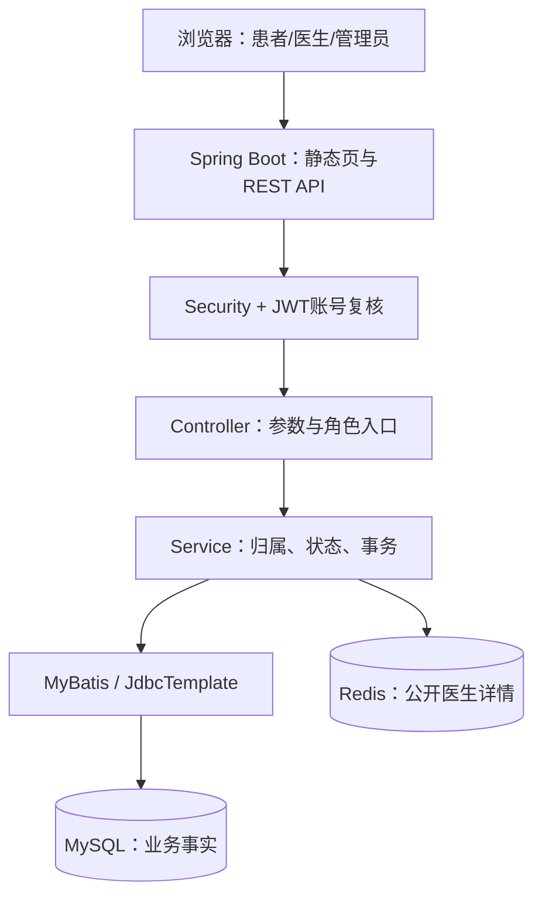

# 架构与取舍

项目是单体，同一数据库中的号源、预约、幂等与历史能在一个事务里提交或回滚，不需要分布式锁、分布式事务或远程库存服务。前端和后端由同一个JAR提供，避免为教学演示增加跨域和额外部署链。

Controller解析JWT和参数；Service决定本人归属、合法状态与事务；Mapper执行明确SQL；数据库用条件更新和唯一约束兜底。前端按钮禁用、菜单隐藏和列表筛选都不能取代后端检查。

创建预约锁顺序包括Slot/父Schedule，取消、超时和签到遵守Slot→Appointment。锁保护当前事实，锁后DB时间处理等待跨过截止；历史写入与主状态同事务。订单式“先扣Redis再异步落库”不属于本系统。

医生详情采用cache-aside：读Redis，miss查MySQL并回填；空值短TTL；资料更新提交MySQL后DEL；Redis不可用短超时降级MySQL。它是可重建缓存，不是库存事实源，也不能当病历缓存模板照搬。

本次新增院内档案是跨表只读聚合，不把所有历史正文塞进一个患者字段；分页/详情在repeatable-read快照中维持一致。编辑当前病历继续走原Encounter入口。

前端按功能拆api/app/booking/clinical/patient-history/business。请求超时、会话更换、迟到响应、失败重试都属于真实用户路径；不能只验证JS语法。源码和Docker版本应在交付证据中分别标注。

不宣称生产可用、医院接入、高可用集群或固定QPS。实际技术版本见pom和Dockerfile；JDK21/Vue3只是早期手册示意，当前保留已验证的Java25/原生JS实现。
