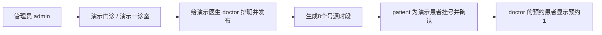

# 第一条真实排班与挂号：照着这个例子使用

> 本文保留2026-10-19单笔操作快照。现已补齐完整三角色数据和未来7天号源，请优先使用[最新指南](DEMO_DATA_GUIDE.md)及[正常库验收](SYSTEM_DEMO_DELIVERY.md)，不要依赖本文固定日期。

2026-10-19 已在当前运行的 Docker 数据库中，通过网页实际创建并确认；不是前端假数据，也不是临时测试库。当前页面保留在 doctor 的「预约患者」，日期选中 2026-10-20。

## 已经替你准备好的数据

| 项目 | 当前实际值 |
| --- | --- |
| 科室 | 演示门诊，ID 1 |
| 诊室 | 演示一诊室，ID 1，属于演示门诊 |
| 医生登录账号 | doctor / 123456 |
| 医生在页面中的姓名 | 演示医生，医生档案 ID 1；已经绑定 doctor 账号 |
| 排班 | #1，2026-10-20 上午 08:00–12:00，已发布 |
| 号源 | 每 30 分钟一段，共 8 段，每段原始容量 10 |
| 患者登录账号 | patient / 123456 |
| 就诊人 | 演示患者，ID 1，归属 patient，全部为虚构资料 |
| 已确认预约 | #1，2026-10-20 08:00–08:30，演示一诊室，状态 BOOKED（已预约） |
| 剩余量 | 本时段 9 / 10；整场 79 / 80，其他时段仍可继续预约 |

「doctor」是登录账号，「演示医生」是医生姓名，两者指向同一位医生。不要再次开通 doctor，也不要再给这个账号绑定第二份医生档案。

当前业务由**管理员分配排班**：管理员在创建排班时选中「演示医生」，排班就归 doctor。医生端自动按登录身份查询本人安排，没有另外的「报名参加排班」或「接受排班」步骤。

## 现在分别到哪里验证

### 管理员看排班

1. 用 `admin / 123456` 登录。
2. 「排班与发布」中查 2026-10-20，可以看到排班 #1 和已发布状态。
3. 点击「查看详情」，检查医生、诊室、日期及 8 个时段；有效预约数为 1。

如果要再排一天：先确保诊室和医生属于同一科室，再点「创建 / 批量排班」，选择「演示门诊 → 演示医生 → 演示一诊室 → 上午门诊」，填写新的未来日期。**创建草稿之后必须发布**，患者才能查到号源。同一医生或诊室的重叠排班会被拒绝。

### 患者看预约或继续挂号

1. 用 `patient / 123456` 登录。
2. 「我的预约」中已经有预约 #1，状态「已预约」。
3. 点击「就诊与病历」，能看到真实的医生、科室、诊室和 10 月 20 日 08:00–08:30。
4. 要再试一次，可到「预约号源」，选「演示门诊 → 演示医生」，日期选 2026-10-20，选另一个时段并选择就诊人。
5. 点「提交预约」后，还需点「立即确认」；停留在待确认会到期关闭。同一就诊人不能重复预约同一有效号源。

新账号先在「就诊人 → 新增就诊人」建立档案；登录账号和实际看病的人是两个概念，一个账号可以为自己和家人预约。

### 医生看自己排班和预约

1. 用 `doctor / 123456` 登录。
2. 「我的排班」中能看到 10 月 20 日的上午排班。
3. 「预约患者」将**就诊日期改为 2026-10-20**，点击「查询预约」。
4. 能看到「演示患者 / 预约 #1 / 08:00–08:30 / 演示一诊室 / 已预约 / 未签到」。

医生首页默认统计今天；「预约患者」默认也查今天。所以 10 月 19 日看今日工作台为 0，不表示明天的排班或预约丢失。刷新页面后请重新核对查询日期。

## 签到和接诊为何现在还不能点

这是一条明天的预约，当前规则要求就诊当天签到。本例可在 **2026-10-20 07:30 起、08:30 前**由 patient 打开「我的预约 → 就诊与病历」签到。不能在 10 月 19 日提前签到。

签到后，doctor 在 10 月 20 日的「候诊与接诊」看到患者。08:00 起可以开始接诊，填写并保存病历，再完成接诊；patient 才能读取已完成病历。现阶段「未签到 / 等待患者签到」属于正确状态。本次已验证到确认预约及医生端可见，未将明日预约伪造成已签到或已接诊。

日期过后，要重新体验预约请排一个新的未来日期；上述日期和 ID 是本次实际操作的快照。

## 实际证据

同一笔数据已用三个账号的 HTTP 接口独立复核：已发布排班、8 条真实 Slot、doctor 本人排班、doctor 能看到 BOOKED 预约 #1、余量只扣一次至 9、患者可查 8 时段、未来日期当前不可签到。[无令牌记录](evidence/live-booking-2026-10-19.json)

[患者预约详情](images/live-patient-booking.png)、[已发布排班](images/live-doctor-schedule.png)。

这些记录保存在当前 Docker 数据卷中，正常停止和启动会保留。无需为此次数据准备重新构建镜像；日常使用仍按 [Docker 使用说明](DOCKER.md)。
