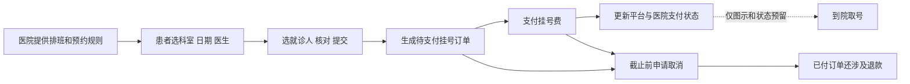
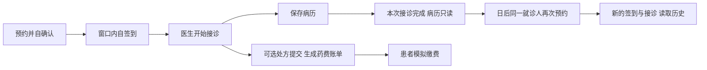

# 尚医通业务研读与 MedFlow 对照

> 本文保留初轮“配套资料”研读的历史状态。此后本地主代码包已经解出，当前以[真实源码逐项对比](SHANGYITONG_CODE_COMPARISON.md)和[业务改造任务单](SHANGYITONG_ADOPTION_PLAN.md)为准；下文“主代码包未读”的描述不是最新状态。不能将模拟器或公开其他版本的行为混同为本地平台实现。

研读日期：2026-10-21。本轮只解压、静态扫描与整理设计，不改MedFlow业务代码，不运行参考项目，不引入新技术栈。

**结论：这套材料把尚医通定位为预约挂号平台，主要值得学习预约规则、日期余量、订单凭证、挂号支付和退号。已读取材料没有完整覆盖医生接诊、病历、处方药费、复诊和完诊，不能把这些环节假装成已经从尚医通源码学到了。MedFlow应保留自己已经实现的接诊和病历模型。**

## 1 解压与证据范围

原目录：`E:\BaiduNetdiskDownload\尚医通\尚医通`。

| 文件 | 本轮结果 |
| --- | --- |
| 笔记.zip，11,683,188字节 | 已解压，含21份Word教案和流程图 |
| 资料.zip，125,344,746字节 | 已解压，含模型/VO、SQL、医院接口模拟系统及工具资源 |
| 代码.zip，69,161,655字节 | Windows读取时提示“文件包含病毒或潜在的垃圾软件”，未能解压，未绕过拦截 |

输出目录：[解压_业务研读](E:/BaiduNetdiskDownload/尚医通/尚医通/解压_业务研读)。两包共解出703个文件；中文名称按压缩包原编码读取。内部的Nacos、Nginx及前端模板ZIP保持文件原样，没有继续安装或运行。

阅读覆盖：医院模拟系统的Java/模板/SQL、平台模型与状态枚举、项目DDL、全部21份Word文本，并重点追踪第15–18课的预约、下单、支付退款、就医提醒；查看了原业务流程图。部分`.doc`实际为OOXML文件，直接读正文XML，无需打开Word或执行宏。

证据有三类：**实际Java源码**、**教案中的示例代码**、**流程图/枚举提出的设计**。下文分别标记；没有对被拦截主代码包作完整审计，没有启动服务、导入SQL、调用微信、做并发实验或运行它的测试。

解压摘要见 [extraction-summary.json](evidence/yygh-study/extraction-summary.json)。教案派生文本暂存 `target/yygh-study/notes-text`；原Word仍在解压目录。内部静态扫描记录在 `target/yygh-study`。

## 2 它的系统边界

原[业务流程图](E:/BaiduNetdiskDownload/尚医通/尚医通/解压_业务研读/笔记/04-尚医通业务流程图/尚医通业务流程.png)分两方：医院提供科室/排班和号源，预约平台负责展示、患者下单及支付，然后通知医院。医生在院内如何写病历，并不在这张平台流程图中。

[第19课项目总结](<E:/BaiduNetdiskDownload/尚医通/尚医通/解压_业务研读/笔记/01-教案/day19 尚医通项目总结.docx>)也只列预约挂号、订单支付/取消、就医提醒等前台功能，没有列医生接诊和电子病历。

流程图中的“管理平台审核”位于医院资料接入到平台展示之间，不能解释成每个患者预约都要管理员批准。教案另有实名认证审批，也不等于预约审批。MedFlow已经确定的**患者自行确认、自行签到**保持不变。

它的预约主线可概括为：

这里的“确认挂号信息”是提交前核对；不能直接等同于MedFlow创建后的PENDING_CONFIRMATION状态。模型中的`GET_NUMBER`意为已取号，不能叫作“医生已完成接诊”。

## 3 按你要求逐段核对

| 环节 | 本套已读资料的实际内容 | 能否作为MedFlow实现参考 |
| --- | --- | --- |
| 挂号 | 科室、日期、上午/下午、医生资料、就诊人、余号、预约下单和号序；有实际模拟代码与教案代码 | 可以，重点学规则和页面信息组织 |
| 签到/取号 | 有建议取号时间、地点、已取号枚举和流程图；医院模拟器没有真正取号/签到接口，教案API也仅列下单/同步支付/取消 | 只能借鉴到院提示，不能声称已有签到实现可照搬 |
| 医生就诊 | 未见医生工作台、候诊队列、接诊状态、病历保存或完成接口 | 无对应实现证据，保留MedFlow现有设计 |
| 缴费 | 教案展示预约挂号费的微信支付、平台支付记录、通知医院和退款 | 学订单/支付/退款分离；不能当作处方药费流程 |
| 复诊 | 已读模型、SQL、教案未见复诊计划、前次就诊关联或独立复诊入口 | 无对应实现证据，后续需自行设计简版业务 |
| 完成 | 有已支付、已取号、取消等订单状态；没有完整接诊完成和病历冻结流程 | 不能把已支付或已取号当作完诊 |

以上“未见”只针对可读资料；主代码包无法读取，不能据此断言其所有版本都没有这些功能。

## 4 预约订单具体怎样形成

### 日期与号源

[第15课预约挂号](<E:/BaiduNetdiskDownload/尚医通/尚医通/解压_业务研读/笔记/01-教案/day15 预约挂号.doc>)先按预约周期生成日期，再聚合该科室每天的排班/剩余量。页面区分“有号、约满、无号、即将放号、停止挂号”，选日期后才展开当天医生，医生分上午/下午展示。

[BookingRule.java](E:/BaiduNetdiskDownload/尚医通/尚医通/解压_业务研读/资料/01-项目实体和vo类/model/com/atguigu/yygh/model/hosp/BookingRule.java:30)集中保存预约周期、每日放号时间、停止挂号时间、退号截止日/时间。值得学的是这些时间含义分别命名，而非让一个deadline承担所有业务。

科室也有层次：[Department.java](E:/BaiduNetdiskDownload/尚医通/尚医通/解压_业务研读/资料/01-项目实体和vo类/model/com/atguigu/yygh/model/hosp/Department.java:33)同时保存大科室与具体科室编码/名称，`DepartmentVo.children`组成树。例如内科大类下可分消化内科、心内科。这是分类导航，不是必须新增一层收费“挂号项目”；小规模MedFlow先保留平铺科室，确有子科室数据再增加层级。

MedFlow已有更细的30分钟slot，不需要退回只有半天的粒度。可以在现有slot上汇总医生每日余量，保留当前“按科室”和“找医生”入口。没有排班、已经约满、已过截止应给出不同原因。

### 提交与订单快照

[第16课预约下单](<E:/BaiduNetdiskDownload/尚医通/尚医通/解压_业务研读/笔记/01-教案/day16 预约下单.doc>)展示：传就诊人ID与排班ID → 读取就诊人/排班规则 → 检查预约时间和余量 → 保存待支付平台订单 → 请求医院下单 → 保存医院返回的记录ID、号序、取号提示 → 更新展示余量和通知。

实际医院端入口为 [HospitalController.java](E:/BaiduNetdiskDownload/尚医通/尚医通/解压_业务研读/资料/05-医院接口模拟系统/hospital-manage/src/main/java/com/atguigu/hospital/controller/HospitalController.java:42)，进入 [HospitalServiceImpl.submitOrder](E:/BaiduNetdiskDownload/尚医通/尚医通/解压_业务研读/资料/05-医院接口模拟系统/hospital-manage/src/main/java/com/atguigu/hospital/service/impl/HospitalServiceImpl.java:48)，读取排班、扣余量、插订单并返回凭证。Mapper继承BaseMapper，医院端DDL在 `hospital-manage/资源文件/sql/表结构.sql`。

[OrderInfo.java](E:/BaiduNetdiskDownload/尚医通/尚医通/解压_业务研读/资料/01-项目实体和vo类/model/com/atguigu/yygh/model/order/OrderInfo.java:36)保存医院/科室/职称、日期和半天、就诊人姓名/电话、金额、号序、取号提示、退号截止等快照。这样用户资料或当前目录变动后，仍可说明当时那笔预约的信息。快照与当前实时资料须在业务上区分，不能所有历史展示都被后来的改名悄悄改变。

平台订单号、医院记录ID、预约号序是三种不同身份。MedFlow单院单体无需增加跨系统ID，但应让用户能分清预约编号与当天候诊顺序，不能拿数据库主键冒充实时排队位置。

### 支付、取消与退款

[OrderStatusEnum.java](E:/BaiduNetdiskDownload/尚医通/尚医通/解压_业务研读/资料/01-项目实体和vo类/model/com/atguigu/yygh/enums/OrderStatusEnum.java:8)仅有：0预约成功待支付、1已支付、2已取号、-1取消。另有[支付记录](E:/BaiduNetdiskDownload/尚医通/尚医通/解压_业务研读/资料/01-项目实体和vo类/model/com/atguigu/yygh/model/order/PaymentInfo.java:27)和[退款记录](E:/BaiduNetdiskDownload/尚医通/尚医通/解压_业务研读/资料/01-项目实体和vo类/model/com/atguigu/yygh/model/order/RefundInfo.java:27)；订单负责预约事实，支付/退款各自记录金额、交易身份和结果。

[第17课微信支付](<E:/BaiduNetdiskDownload/尚医通/尚医通/解压_业务研读/笔记/01-教案/day17 微信支付.doc>)实际示例是页面轮询、服务端向支付方查询，确认成功后更新支付流水/订单，再通知医院。虽然字段叫`callbackTime`，不能据此断言已做可靠的支付异步回调。

取消区分未支付与已支付，已支付还涉及退款及号源释放。但教案文字写“先退款再通知医院”，展示的`cancelOrder`片段却先调用医院取消、再退款；不能把说明文字当成代码实际顺序。对我们的启发是列清“预约取消、钱退回、容量释放”三种结果及失败处理，而不是照搬它的跨系统调用。

`SignInfoVo`中的Sign是接口**签名**信息，不是患者签到。[原字段](E:/BaiduNetdiskDownload/尚医通/尚医通/解压_业务研读/资料/01-项目实体和vo类/model/com/atguigu/yygh/vo/order/SignInfoVo.java:20)是医院编码、接口地址和签名密钥。

## 5 教学示例中不能直接照搬的地方

这些是静态阅读结论，未运行参考系统或复现并发：

1. 医院模拟下单先把余量减1，再判断新余量`> 0`，导致原余量为1时不能挂最后一个号。证据：[HospitalServiceImpl.java:77](E:/BaiduNetdiskDownload/尚医通/尚医通/解压_业务研读/资料/05-医院接口模拟系统/hospital-manage/src/main/java/com/atguigu/hospital/service/impl/HospitalServiceImpl.java:77)。
2. 下单是普通select后按旧值updateById，未见条件扣减/锁保护，存在并发容量与号序冲突风险；有事务注解不代表竞争自动安全。MedFlow现有条件扣减、锁顺序、幂等和唯一约束应保留。
3. 医院端取消只改状态与退号时间，没有回补号源；支付和取消直接覆盖状态。证据：[同步支付:116](E:/BaiduNetdiskDownload/尚医通/尚医通/解压_业务研读/资料/05-医院接口模拟系统/hospital-manage/src/main/java/com/atguigu/hospital/service/impl/HospitalServiceImpl.java:116)、[同步取消:131](E:/BaiduNetdiskDownload/尚医通/尚医通/解压_业务研读/资料/05-医院接口模拟系统/hospital-manage/src/main/java/com/atguigu/hospital/service/impl/HospitalServiceImpl.java:131)。平台教案另有更新余量逻辑，但不能替代医院端事实一致性。
4. 医院患者处理明确写“业务：略”，固定返回`1L`，无法当作真实就诊人档案设计。证据：[savePatient:154](E:/BaiduNetdiskDownload/尚医通/尚医通/解压_业务研读/资料/05-医院接口模拟系统/hospital-manage/src/main/java/com/atguigu/hospital/service/impl/HospitalServiceImpl.java:154)。
5. 示例取号时间拼接有字段混用，院端存的窗口与响应返回的窗口也不同（同文件89–105）；适合借鉴“需提供到院信息”，不适合直接复制固定文字。
6. 第17课支付片段先标本地已支付，再通知医院；若通知失败，重试又因本地不再UNPAID而直接返回，片段未展示补偿。因此不能把先查状态再return称为完整可靠幂等。

保留错误案例很适合学习：余量1、重复提交、取消后回补一次、重复支付、跨患者读取、旧通知迟到，都可以用来解释当前项目为什么需要那些约束。

## 6 回到MedFlow怎样组织整条记录

本轮重新核对当前源码，现状是：

| 业务事实 | 当前实现 | 主要源码 |
| --- | --- | --- |
| 预约 | PENDING_CONFIRMATION→患者确认BOOKED；取消/超时按规则回补 | [AppointmentService](E:/code/java/MedFlow/src/main/java/com/qqlin/medflow/appointment/service/AppointmentService.java) |
| 到院签到 | 本人BOOKED且在时间窗内才创建WAITING；重复复用 | [EncounterService.checkIn](E:/code/java/MedFlow/src/main/java/com/qqlin/medflow/encounter/service/EncounterService.java:29) |
| 医生接诊 | WAITING→IN_PROGRESS；保存病历版本；完成→COMPLETED；可过号 | [EncounterService.start/complete](E:/code/java/MedFlow/src/main/java/com/qqlin/medflow/encounter/service/EncounterService.java:86) |
| 处方/药费 | 草稿→提交冻结明细并生成账单；患者模拟缴费 | [PrescriptionService](E:/code/java/MedFlow/src/main/java/com/qqlin/medflow/billing/service/PrescriptionService.java:80) |
| 历史 | 按同一patientId聚合跨日期、跨医生的已完成正文/已提交处方 | [PatientHistoryService](E:/code/java/MedFlow/src/main/java/com/qqlin/medflow/patient/history/PatientHistoryService.java) |
| 复诊 | 能再次普通预约并看历史；尚无前次接诊关联、复诊计划或专用入口 | 当前源码与迁移搜索未见专用模型，不能记为完整复诊模块 |

应这样理解你的流程：

**缴费完成、接诊完成、复诊是不同事实。** 当前代码允许无处方完成接诊，也允许已提交处方仍待缴费时完成；不会等待患者支付才冻结病历，见 [complete:135](E:/code/java/MedFlow/src/main/java/com/qqlin/medflow/encounter/service/EncounterService.java:135)。签到后预约仍为BOOKED，Encounter另行变化；这是模型分离，不是数据库漏更新。

另一个应如实讲出的边界：已确认但超过就诊时间仍未签到的预约，目前仍为BOOKED，没有NO_SHOW/爽约自动归档。EXPIRED专指未确认超时，不能拿来混用。后续可先在读取页面明确“已过就诊时间且未签到”，是否增加爽约状态和自动任务需要另定规则。

复诊应形成新预约、新接诊和新病历，旧病历继续只读。若以后增加“复诊”功能，可用前次encounterId、复诊原因和建议日期表达关联，但仍由患者选择可用号源并确认，不能默认替患者占号。此段为**建议，尚未实施**。

## 7 后续建议 按业务价值排序

| 优先级 | 可做内容 | 不增加技术栈的做法 | 当前状态 |
| --- | --- | --- | --- |
| 1 | 统一就诊凭证和下一步提示 | 在现有详情汇总医生/诊室/日期时段、签到窗口、取消截止；明确预约/接诊/账单各自状态 | 现有字段可复用，建议进一步统一页面，未在本轮修改 |
| 2 | 日期余量与空态原因 | 基于MySQL现有slot按天聚合；区分无排班、约满、已截止 | 有日期和时段选择，完整日期状态汇总待设计 |
| 3 | 轻量复诊关联 | 同患者新预约可关联原已完成接诊，医生读原病历、填写本次结果 | 专用关联与入口未实现 |
| 4 | 历史业务快照范围 | 明确预约时医生/科室/诊室哪些字段应保留快照，提交处方已有价格快照继续保留 | 预约目录信息目前主要实时联表，新增快照需新迁移与规则 |

目前不建议为了“像尚医通”增加挂号收费：MedFlow已有的是处方药费模拟账单，新增挂号费会同时带来待缴保留、取消退款等规则。先把现有闭环讲清楚，再决定是否需要。真实微信、短信、医院对接、微服务、Nginx、MongoDB、Nacos和MQ都不纳入这份建议的实施范围。

## 8 后续怎么吃透

每次只学一条纵向动作，用“谁点按钮→页面拿什么ID→API→Service规则→SQL/约束→状态和失败→页面下一步”解释。不要按框架名称平铺学习。

1. 先读本报告第2–3节和原业务流程图，说明预约平台与单院诊疗系统的边界，分清挂号费、药费、取号、签到和接诊。
2. 读第15课与BookingRule/排班模型，对照MedFlow booking.js和slot查询；自己解释有号/约满/无班/截止。
3. 读第16课下单片段与医院模拟submitOrder，再追MedFlow AppointmentService；重点比较事务、幂等、最后1个号与取消回补，不学习Feign/MQ接线。
4. 从MedFlow签到追到Encounter、病历版本和完成规则；这部分以我们的真实源码为主，尚医通没有可读对应实现。
5. 读第17课支付/退款，理解预约订单与交易流水职责；再看我们的PrescriptionService和模拟支付，不申请真实商户或配置密钥。
6. 用同一个虚构patientId完成两次日期不同的预约/接诊，查看旧病历，区分“再次预约可用”和“专用复诊模块未做”。

当前完整学习任务沿用 [LEARNING_CHECKLIST](LEARNING_CHECKLIST.md)，手点沿用 [MANUAL_ACCEPTANCE](MANUAL_ACCEPTANCE.md)。新教学窗口应先读本报告，再讲当前源码，不把参考教案的示意流程当作MedFlow已经实现的功能。

本轮只交付研究结论；以上改进候选没有自动转成开发任务。
