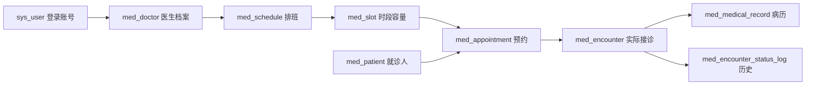

# MedFlow 两天学习与演示指南

目标是在已实现代码上吃透“管理员排班 → 患者预约确认 → 当日签到 → 医生接诊 → 病历完成 → 患者查看结果”，能从页面沿 API、Service、SQL 和数据库约束解释成功与失败。按每天至少 6 小时安排，下面主线合计约 13 小时；阅读时间不等于理解保证，每个时段以可复述、可演示的产出验收。

需求与边界见 [两天交付需求](TWO_DAY_DELIVERY_REQUIREMENTS.md)，实际页面步骤见 [前端使用说明](FRONTEND.md)。本指南给出源码入口和验证办法，不声明脚本已在当前环境运行通过。

## 先掌握三个业务事实

1. **预约预订资源。** 创建预约时扣容量，确认不再次扣容量；有效取消或未确认超时关闭才归还。`BOOKED` 表示预订已确认。
2. **接诊记录实际到院过程。** 已确认患者在指定窗口签到后创建 Encounter。完成和过号都不归还容量，预约仍保留 `BOOKED`。
3. **病历属于一次接诊。** 每次接诊本版本最多一份四字段病历；医生可保存草稿，完成后只读，患者仅看到完成后的正文。



`sys_user.id`、`med_doctor.id`、`med_patient.id` 是不同身份。患者账号可以拥有多位就诊人；医生账号映射到医生档案；不能把前端传的 `doctorId` 当作当前登录医生。

## 第一天：身份、资源和签到，约 6.5 小时

| 时间 | 阅读与操作 | 必须产出的理解证据 |
| --- | --- | --- |
| 0:00–0:45 | 管理员登录，创建一个新医生账号并用它登录；读 SecurityConfig、JWT 身份解析和 DoctorAccountService | 画出 JWT uid → 医生档案的映射；解释为什么账号和档案要同事务 |
| 0:45–2:00 | 建科室、诊室；读 ScheduleService 与批量管理 Service；创建两日期草稿并发布 | 画出草稿到 Slot 的生成流程；解释资源冲突和任意日期失败时的整体回滚 |
| 2:00–3:15 | 查看服务端排班目录与取消实现，构造已有预约的取消失败 | 按源码写出取消出诊与创建预约各自的锁顺序，说明为什么不能反过来 |
| 3:15–4:30 | 创建并确认预约；复习幂等键、容量、确认/取消/超时的旧主线 | 用一笔预约说明何时扣减、何时归还、重试重放什么结果 |
| 4:30–5:45 | 阅读 checkIn，使用合规当天数据演示签到；比较取消流程 | 解释为什么签到和取消要争用同一个 Slot、Appointment；说明锁后读取时间的原因 |
| 5:45–6:30 | 运行相关单测、整理失败案例并脱离编辑器复述 | 连续 5 分钟讲完身份→排班→预约→签到，回答下面对应问题 |

### 1. 医生开通与本人数据权限

调用链：管理页 `app.js` 的 `viewDoctors` → `api.doctors.createAccount` → [DoctorAccountController](../src/main/java/com/qqlin/medflow/organization/provisioning/DoctorAccountController.java) → [DoctorAccountService.create](../src/main/java/com/qqlin/medflow/organization/provisioning/DoctorAccountService.java) → `sys_user` 和 `med_doctor`。

管理员选择科室、输入初始密码；后端校验启用科室并用 BCrypt 编码密码，角色固定为 `DOCTOR`。同一 `@Transactional` 方法插入账号和档案；用户名唯一约束冲突转成业务异常，让异常越过事务边界触发回滚，不提交孤立账号。

[SecurityConfig](../src/main/java/com/qqlin/medflow/identity/security/SecurityConfig.java) 按 ADMIN/DOCTOR/PATIENT 拦截路由；[JwtAccountValidator](../src/main/java/com/qqlin/medflow/identity/security/JwtAccountValidator.java) 复核账号。医生列表和接诊接口继续从 JWT uid 查询 `med_doctor.user_id`，在 SQL 中限定本人 `doctor_id`，实现对象级权限。患者详情则经 `med_patient.owner_user_id` 过滤。角色门禁和数据归属都需要。

复述题：

- 医生账号开通失败时，怎么证明没有账号成功但档案失败的半完成状态？
- 有 DOCTOR 角色为什么还不够？医生 A 猜到医生 B 的 encounter ID 时在哪里被拦住？
- 为什么患者登录账号不是 `med_patient` 就诊人记录？

### 2. 排班、批量与发布

调用链：`clinical.js` 的 `adminSchedules` / `openScheduleCreation` → `api.scheduleManagement` → [ScheduleManagementService](../src/main/java/com/qqlin/medflow/scheduling/management/ScheduleManagementService.java) → [ScheduleService](../src/main/java/com/qqlin/medflow/scheduling/service/ScheduleService.java) → `med_schedule`、`med_slot`。查询与取消 SQL 见 [ScheduleManagementMapper.xml](../src/main/resources/mapper/scheduling/ScheduleManagementMapper.xml)。

批量请求是“同一医生、诊室、班次 + 1 至 7 个不重复未来日期”。`createBatch` 在一个 READ COMMITTED 事务内按日期排序逐个调用现有建草稿逻辑；任一日期业务失败向外抛异常，整个事务回滚。复用不同 Service Bean 的方法，事务传播加入现有事务。外层隔离级别决定整个批次，不能误以为每一天单独提交。

现有 `createDraft` 按 Doctor→ClinicRoom 的固定顺序锁资源行，再查询重叠排班并插入。这使同一资源的并发创建串行；READ COMMITTED 下锁后查询能看到之前等待的事务刚提交的排班，同时避免用旧快照或不必要范围锁保护空区间。发布则把排班状态变化与整批 Slot 插入放在同一事务，不留下“已发布但号源只生成一半”的状态。

草稿保存班次快照，发布后才拆成 Slot 并对患者开放；目录来自数据库，筛选、分页和详情不能依赖浏览器上次保存的草稿。创建一次批量并不意味着接口拥有“同键重试返回同结果”的幂等契约，超时后先查目录确认。

复述题：

- 批量第 3 天冲突，前两天的排班为什么不会留在数据库？
- 为什么前端禁止重复日期不够，Service 还要校验？
- 同一时段同医生/诊室冲突与“某一天有多次排班”有什么区别？

### 3. 受限取消出诊与预约竞争

管理员取消入口：`POST /api/v1/admin/schedules/{id}/cancel` → `ScheduleManagementService.cancel`。允许条件是开诊前、草稿或已发布、没有待确认或已确认预约。成功记录 `cancel_reason`、`cancelled_by`、`cancelled_at`；重复取消直接返回原状态。

对已发布排班，取消逻辑先按 ID 顺序锁定其 Slot，再锁 Schedule，锁后读数据库时间并复核有效预约。创建预约通过 [SlotMapper.xml](../src/main/resources/mapper/scheduling/SlotMapper.xml) 同时取得 Slot 排他锁和 Schedule 共享锁，复核发布状态后扣容量。取消不能先拿 Schedule 排他锁再等 Slot，否则和预约的 Slot→Schedule 路径可能形成反向等待。草稿如果在等待期间被另一事务发布，取消应失败，不能持有 Schedule 锁再补锁新 Slot。

目标结果只有两种：预约先成功，取消因有效预约失败；或取消先成功，预约因排班已取消失败。本版本不做已有预约的自动退约、改约和通知。

复述题：

- 只在方法开头查一遍“没有预约”为什么不安全？
- 等锁前捕获的 `now` 为什么可能让过期开诊取消成功？
- 一条取消 SQL 成功，如何证明它和预约容量、有效预约条件一致？

### 4. 预约确认与签到

旧预约主线读 [AppointmentService](../src/main/java/com/qqlin/medflow/appointment/service/AppointmentService.java) 的 `create`、`confirm`、`cancel`、`expirePending`。创建的幂等记录、容量扣减、预约、初始历史在一个事务内；`sys_idempotency_record` 的唯一键区分命令重试，预约唯一约束区分业务重复。确认只把待确认变为 `BOOKED`，不再扣容量。

新增签到链：患者 `clinical.js.openPatientVisit` → `visitInfo` 查看真实时段和服务端 `canCheckIn` → `POST /api/v1/appointments/{id}/check-in` → [EncounterService.checkIn](../src/main/java/com/qqlin/medflow/encounter/service/EncounterService.java) → [EncounterMapper.xml](../src/main/resources/mapper/encounter/EncounterMapper.xml)。

签到只允许本人已确认预约，且数据库当前日期为就诊日、时间满足 `[时段开始 - 30分钟, 时段结束)`。先锁 Slot，再锁 owned Appointment，然后重新读取数据库时间。重复签到在锁内查到已有 Encounter，返回原接诊；`med_encounter.appointment_id` 唯一约束再兜底。

原取消流程同样使用 Slot→Appointment，在锁内检查是否已经存在 Encounter。若签到先提交，取消看到接诊记录而失败；若取消先提交，签到看到预约已取消而失败。签到本身不扣也不退容量。

复述题：

- 为什么不直接在预约表增加“就诊中、已完成”状态？
- 同预约两个请求同时签到，哪一层串行、哪一层防重复？
- 浏览器显示可签到，提交却返回 409，是哪条业务规则发生了变化？
- 已完成时预约仍为 BOOKED，统计就诊量应查哪张表、哪个状态？

## 第二天：接诊、病历、前端与证据，约 6.5 小时

| 时间 | 阅读与操作 | 必须产出的理解证据 |
| --- | --- | --- |
| 0:00–1:15 | 医生本人队列、开始接诊、过号；读 Service、状态 SQL 与 V9 约束 | 画出接诊状态机；解释并发开始两次为什么最多一人就诊中 |
| 1:15–2:45 | 病历草稿保存、版本冲突、完成及患者读取 | 用两标签页复现旧版本冲突；讲清 version=0、首次返回1、完成只读 |
| 2:45–3:45 | 从 clinical.js 和 api.js 跟踪一次真实页面提交 | 指出防双击、过期响应隔离、409保留文字、API错误/401处理的位置 |
| 3:45–5:00 | 普通测试与隔离MySQL/HTTP脚本，按输出记录结果 | 区分 Mock、真实数据库并发、真实HTTP和浏览器布局分别证明什么 |
| 5:00–6:00 | 三角色完整演示及两个失败分支，保留虚构数据与日志 | 可在8分钟内演示闭环，并解释一种越权、一种并发和一种版本冲突 |
| 6:00–6:30 | 对照下面的复述题补缺，整理简历描述 | 只写已实现且已验证的能力，标明尚未覆盖的扩展边界 |

### 5. 接诊状态机和单医生串行

```text
签到 → WAITING → IN_PROGRESS → COMPLETED
           └──→ SKIPPED
```

前端入口是 `clinical.js.doctorQueue` 和 `openDoctorEncounter`，后端是 `EncounterService.start/skip/complete`。医生身份来自登录态；开始要求本人 WAITING 接诊且该时段已经开始。队列查询按时段开始、签到时间、ID 排序。

`start` 先锁本人医生行，再锁目标 Encounter，查该医生是否已有 `IN_PROGRESS`。医生行是跨两条不同接诊记录的串行点；只锁目标接诊行不能阻止两个不同患者同时开始。V9 还定义生成列 `attending_doctor_id`：只在 `IN_PROGRESS` 时取医生ID，其他状态为 NULL；唯一索引让数据库拒绝同一医生多个进行中接诊。

状态迁移用 `WHERE status = 预期状态` 的条件更新，迁移和 `med_encounter_status_log` 在同一事务提交。重复开始已就诊中、重复过号已过号、重复完成已完成均返回原结果；其他非法迁移返回冲突。过号在本版本为终态，不提供补叫；完成和过号不增加 Slot 容量。

复述题：

- 为什么锁 Encounter 行还不够，要锁 Doctor 行？
- 生成列唯一约束为什么允许多个 WAITING，却不允许两个 IN_PROGRESS？
- 状态更新成功但历史插入失败时，用户最后应该看到什么？
- 返回409和直接覆盖状态相比，保住了什么业务事实？

### 6. 病历版本、完成与正文权限

读 `EncounterService.saveMedicalRecord/complete/patientDetail`、[V9 迁移](../src/main/resources/db/migration/V9__create_encounter_tables.sql) 和 `EncounterMapper.xml` 的 `insertMedicalRecord/updateMedicalRecord/transition`。

只允许本人 `IN_PROGRESS` 下保存四字段。首次请求带 `version=0`，插入后数据库病历版本为1；后续提交带当前版本，更新 SQL 使用 `WHERE encounter_id = ? AND version = ?` 并递增。接诊行锁串行保存/完成，版本仍用来识别用户拿着旧页面内容提交，避免静默覆盖。

完成要求已有病历、主诉和诊断非空、版本一致，完成状态与历史在一个事务内提交。`med_encounter.version` 跟踪接诊状态迁移，`med_medical_record.version` 跟踪病历正文保存；完成请求传的是后者。完成后原保存入口拒绝正文写入。

`patientDetail` 先验证就诊人所属账号，只在 `COMPLETED` 时装配 `medicalRecord`；否则返回接诊摘要而正文为空。前端再按完成状态决定是否渲染，后端才是保密边界。管理员没有获得医生正文访问权。

复述题：

- 已经有行锁，为什么还要病历版本号？
- 首次保存提交0，成功后为什么必须用返回的1继续提交？
- 两标签页同版本保存，第二次怎么被识别为旧内容？
- 为什么“前端隐藏textarea”不能保护草稿正文？
- 当前只读终稿不等于真实医疗文书修订系统；如果要更正病历，需要新增什么流程？

### 7. 前端如何对应后端事实

主要阅读 [clinical.js](../src/main/resources/static/assets/clinical.js)、[api.js](../src/main/resources/static/assets/api.js) 和 [app.js](../src/main/resources/static/assets/app.js) 的 `clinicalContext`、菜单路由及预约列表接入。

| 场景 | 当前处理 | 为什么需要 |
| --- | --- | --- |
| 查询日期/状态快速切换 | 请求序号与 `isConnected` 检查 | 旧响应不能覆盖新筛选，也不能写入已经关闭的页面 |
| 连点开始/签到/保存/创建 | busy标志和控件禁用 | 减少重复请求；最终正确性仍由后端事务/约束保证 |
| 病历编辑后直接完成 | 比较当前字段与保存快照 | 未保存内容不会被误认为已经写入数据库 |
| 病历版本409 | 保留当前输入，提供明确重载操作 | 避免错误处理把医生未保存文字清空 |
| 签到成功 | 重新查询 visit-info 和 Encounter | 显示后端真实状态，不凭点击结果伪造完成状态 |
| 患者未签到 | 接诊GET返回404作为正常缺失 | 缺少接诊不应让有效预约详情整体报错 |
| 后端字符串 | HTML转义后插入 | 姓名、诊断、医嘱或错误消息不能变成脚本 |
| 登录过期或账号切换 | api.js验证会话并处理401/旧会话响应 | 过期请求不能污染新账号页面 |

复述题：`busy` 为什么不能替代服务端防重？版本冲突后为什么不能自动重新用新版本提交旧正文？打开新弹窗后旧请求才返回，代码在哪一步阻止它覆盖新弹窗？

## 验证入口与证据口径

先运行不依赖真实数据库的普通测试：

```powershell
.\mvnw.cmd test
node --test tools/test-frontend-api.cjs tools/test-frontend-dashboard.cjs tools/test-frontend-workflows.cjs tools/test-frontend-clinical.cjs
```

重点测试文件：

- [DoctorAccountServiceTest](../src/test/java/com/qqlin/medflow/organization/provisioning/DoctorAccountServiceTest.java)：账号开通、密码和档案事务边界相关逻辑。
- [ScheduleManagementServiceTest](../src/test/java/com/qqlin/medflow/scheduling/management/ScheduleManagementServiceTest.java) 与 Controller 测试：查询、批量、取消条件和角色门禁。
- [EncounterServiceTest](../src/test/java/com/qqlin/medflow/encounter/EncounterServiceTest.java) 与 Controller 测试：签到、状态、病历、版本、权限与响应。
- [前端临床测试](../tools/test-frontend-clinical.cjs)：直接执行模块源码，检查关键提交、冲突保留、签到重读、患者可见性和异步竞争。

普通 Service Mock 测试只能验证调用分支，不能证明 InnoDB 锁、生成列、事务整体回滚。随后在独立临时MySQL环境运行：

```powershell
.\tools\test-confirmation.ps1 -TestSelection 'EncounterConcurrencyMySqlIT,ScheduleManagementMySqlIT'
.\tools\test-clinical-http.ps1
```

[EncounterConcurrencyMySqlIT](../src/test/java/com/qqlin/medflow/encounter/EncounterConcurrencyMySqlIT.java) 和 [ScheduleManagementMySqlIT](../src/test/java/com/qqlin/medflow/scheduling/management/ScheduleManagementMySqlIT.java) 提供真实数据库边界复现入口；[test-clinical-http.ps1](../tools/test-clinical-http.ps1) 启动隔离MySQL与应用，联通实际HTTP接口。脚本参数和本机工具要求以文件为准，不要把测试连接指向正常业务数据库。

手动演示采用虚构数据。管理员正常排班只支持未来日期，签到只支持当天窗口，不能为了演示改系统时钟或放宽生产校验。可提前创建明日排班，次日按时演示；即时测试应由隔离测试夹具准备符合当前数据库时间的当天记录。

记录实际命令、运行时间、成功/失败数和关键断言；自动测试通过后再检查桌面与手机页面、长病历、空列表和错误提示。历史验收数字不能替代当前新增业务结果。

## 8分钟演示与简历表达

| 时长 | 演示 | 讲解重点 |
| --- | --- | --- |
| 1分钟 | 管理员开通医生、查看排班目录 | 账号/档案原子创建，服务端查询 |
| 1分钟 | 排班详情、发布，展示取消被预约阻止 | 资源快照、Slot生成、受限取消边界 |
| 1分钟 | 患者选择科室/医生/时段并确认 | 有限容量与幂等重试 |
| 1分钟 | 合法当天预约签到 | 预约和接诊分离、时间窗口、取消竞争 |
| 2分钟 | 医生队列、开始、保存、完成 | 本人权限、单医生单接诊、病历版本 |
| 1分钟 | 患者查看完成结果 | 草稿正文不返回、终稿只读 |
| 1分钟 | 展示一种失败及对应测试证据 | 讲清条件、结果和为什么不会留下错误副作用 |

简历可围绕三条已验证能力写，先填真实验收结果，再采用这些表述：

- 基于 Spring Boot/MyBatis 实现管理员、医生、患者三角色门诊闭环，使用登录身份映射和对象归属限制医生本人接诊、患者本人记录。
- 通过统一资源锁顺序、事务和数据库唯一约束处理取消出诊与预约、签到与取消、同医生并发接诊，保存一致的状态历史。
- 将病历独立到接诊记录，使用版本检查避免旧页面覆盖，完成后只读，患者仅可查看已完成正文；以普通测试、隔离MySQL并发及HTTP链路证明对应边界。

不要填写未经运行的并发吞吐量、性能提升百分比或测试数量。药品处方、真实支付/医保、完整停诊补偿、补叫插队、多次病历修订、FHIR与微服务不属于本轮已交付能力。两天先把这条主线讲清，再扩展下一阶段。
